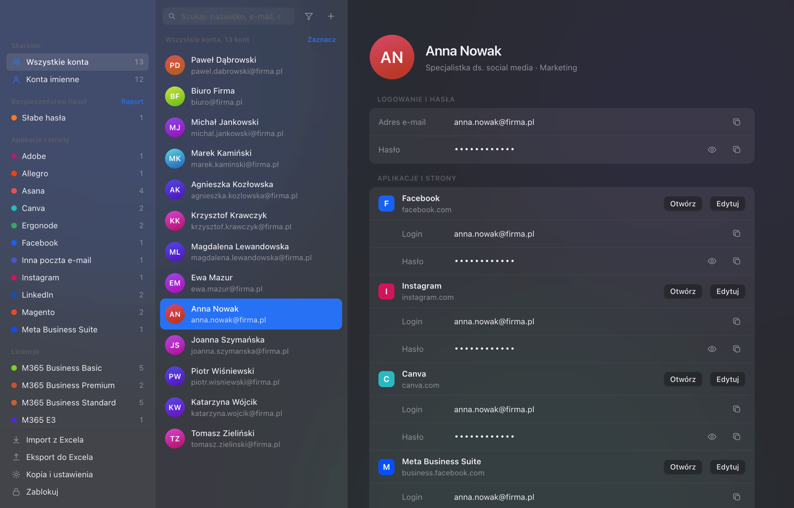

# 🔐 Skarbiec

**Zaszyfrowany sejf na firmowe konta Microsoft 365 i dostępy do aplikacji – dla osoby, która w małej firmie „robi IT”.**

Skarbiec trzyma w jednym miejscu konta pracowników, ich hasła, licencje i dostępy do innych serwisów (Facebook, Instagram, Asana, Magento, Ergonode, Adobe…). Synchronizuje się z Microsoft 365, pilnuje jakości haseł i działa w pełni lokalnie – bez chmury, bez serwera, bez kont.



<sub>Na zrzucie dane wymyślone na potrzeby prezentacji.</sub>

## Dlaczego Skarbiec?

W małej firmie hasła żyją zwykle w arkuszu Excela, notesie albo w głowie jednej osoby. Skarbiec zastępuje taki arkusz porządną, zaszyfrowaną aplikacją, a jednocześnie potrafi go wczytać – przejście trwa kilka minut.

## Najważniejsze funkcje

### 👥 Konta i dostępy
- Konta pracowników: e-mail, hasło (i kolejne hasła), licencje, dział, stanowisko, telefony, własne pola, uwagi.
- **Aplikacje i strony** – osobno dla każdej osoby: Facebook, Instagram, inna poczta, Asana, Magento, Ergonode i dowolne własne. Raz dopisana aplikacja (np. Adobe) pojawia się jako szybki przycisk u kolejnych osób, razem z adresem strony.
- Nadawanie dostępu wielu osobom naraz – z osobnym, wygenerowanym hasłem dla każdej.
- Błyskawiczne wyszukiwanie (bez polskich znaków, po telefonie, po nazwie aplikacji) i łączone filtry: licencja, dział, stanowisko, biuro, aplikacja, konta imienne.

### ☁️ Microsoft 365
- Synchronizacja kont przez Microsoft Graph (logowanie kodem urządzenia, bez zakładania aplikacji w Azure).
- Wykrywa hasła zmienione w Microsoft 365 i konta usunięte z organizacji.
- Opcjonalnie: masowa zmiana haseł wybranym użytkownikom prosto ze Skarbca (generator + zapis w Microsoft 365).
- Wykorzystanie licencji: przypisane / kupione / wolne.

### 🛡️ Bezpieczeństwo
- **AES-256-GCM** z kluczem z **scrypt** (N = 2²⁰, r = 8, p = 2 – ok. 1 GB pamięci na każdą próbę hasła); szyfrowane są także ustawienia i dziennik.
- Blokada zrzutów ekranu, nagrywania i udostępniania ekranu (Teams, Zoom).
- Hasła w schowku oznaczone jako poufne (nie trafiają do menedżerów schowka ani na iPhone’a) i czyszczone automatycznie.
- Autoblokada po bezczynności, przy uśpieniu i blokadzie ekranu; rosnące opóźnienie po błędnym haśle.
- **Przegląd bezpieczeństwa**: słabe, powtórzone (także między aplikacjami), stare hasła i hasła z wycieków – sprawdzane w Have I Been Pwned metodą k-anonimowości (z komputera wychodzi tylko 5 znaków skrótu).
- Zaszyfrowany **dziennik zdarzeń**: kto i kiedy wyświetlił, skopiował lub zmienił hasło.

### 🧰 Na co dzień
- Import i eksport Excela (także eksport użytkowników z centrum administracyjnego Microsoft 365).
- **Karta dostępu** dla pracownika – wydruk lub PDF z loginem, hasłem, dostępami i instrukcją.
- Wysyłka hasła SMS-em: przez iPhone’a połączonego z Makiem albo bramkę SMSAPI.pl.
- Zaszyfrowane kopie zapasowe, natywne menu i skróty klawiszowe macOS.

## Instalacja

Pobierz plik `.dmg` z zakładki **Releases** (Apple Silicon: `arm64`, Intel: `x64`) i przeciągnij Skarbiec do Aplikacji.

Aplikacja jest podpisana ad-hoc, więc przy pierwszym uruchomieniu macOS poprosi o potwierdzenie: prawy przycisk → **Otwórz** albo Ustawienia systemowe → Prywatność i ochrona → **Otwórz mimo to**.

Wymagania: macOS 11 lub nowszy. Działa też na Windows (budowanie ze źródeł).

## Uruchomienie ze źródeł

Wymagany Node.js 20+.

```bash
npm install
npm start
```

Budowanie paczek:

```bash
npm run dist:mac   # .dmg i .zip dla Apple Silicon i Intel
npm run dist:win   # instalator .exe i wersja przenośna
```

## Dokumentacja

Pełny opis funkcji, importu, synchronizacji z Microsoft 365, SMS-ów i ustawień bezpieczeństwa: **[docs/INSTRUKCJA.md](docs/INSTRUKCJA.md)**.

## Technologie

Electron · Node.js · Web Crypto / scrypt · Microsoft Graph · ExcelJS

---

Autor: **Tomasz Marchewka** · wersja 1.10.3
